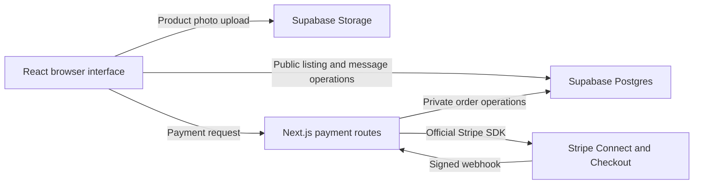
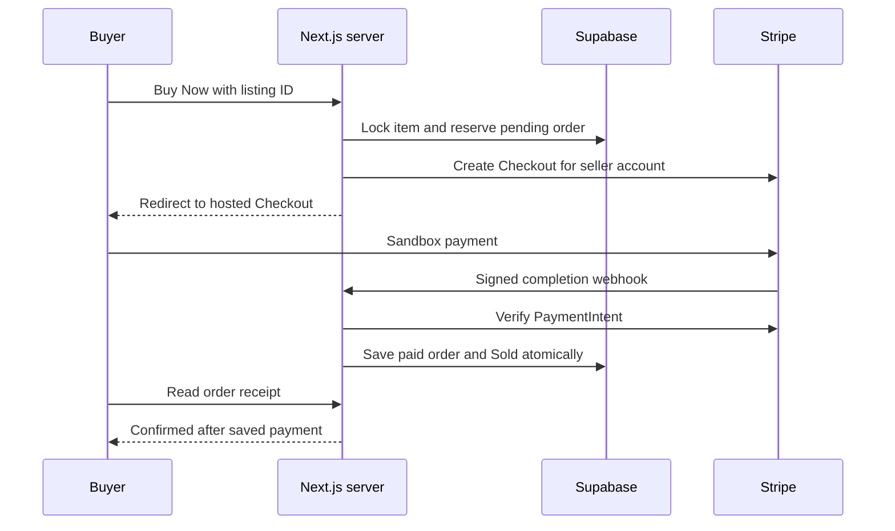

# Marketplace interview notes

Study guide for Javer's Test 3 Marketplace and Test 4 Stripe Connect work. Based on branch `test4-stripe-connect`, application revision `798a97a`, and checks completed on November 21, 2026.

Start with [the quick review sheet](INTERVIEW_CHEAT_SHEET.md). Use the sample answers to practise in your own words. Explain only what you understand and have actually verified.

## 1. Your 45-second introduction

> This project started as a mini-marketplace where visitors can upload a product photo, publish a listing, browse by category, search, and message sellers without logging in. I extended it with Stripe Connect so sellers can complete hosted onboarding and buyers can pay through Stripe Checkout. Payments are sandbox-only, and the platform takes a 10% application fee. The server reserves the item before Checkout and marks it Sold only after a verified Stripe webhook confirms payment. The stack is React, Next.js, TypeScript, Supabase Postgres and Storage, with Vercel as the deployment target.

Be ready to explain the payment flow without reading this paragraph.

## 2. What each technology does

| Technology | Its actual role here |
| --- | --- |
| React | Interactive forms, previews, filters, loading/error states and payment controls |
| Next.js App Router | Pages, shared layout, dynamic `/item/[id]` URLs and server payment route handlers |
| TypeScript | Describes listing, seller, order and gateway shapes; catches many mistakes before runtime |
| Tailwind CSS and UI primitives | Responsive layouts and reusable controls |
| Supabase Postgres | Listings, buyer messages, seller account mappings and orders |
| Supabase Storage | Uploaded product photos; the listing stores the image path |
| Stripe Connect | Seller connected accounts and payment routing |
| Stripe Checkout | Stripe-hosted payment page; the app does not implement a card-input form |
| Vercel | Existing Test 3 hosting and the planned separate Test 4 production deployment |

Installed versions include Next.js 16.4.6, React 19.3 and Stripe SDK 23.2.0. Read `package.json` rather than describing this as the Next.js 15 example from the assignment.

### Browser versus server

The original listing, photo and message flows call Supabase from the browser with a publishable key. Database grants, row-level security and constraints control what a visitor can do.

Payment operations go through Next.js server routes. The server uses private Stripe and Supabase credentials to create accounts, reserve orders, create Checkout and process webhooks. [The server context](lib/payments/server.ts) imports `server-only`.



## 3. Explain the original Marketplace

**Create listing:** validate the form and photo, upload the photo under a random UUID filename, insert the listing row, then navigate to the new item URL. Upload and INSERT are separate operations: a failed INSERT can leave an orphaned photo. See [the create form](app/create/item/page.tsx).

**Browse/search:** load listings in successive ranges of 200, then filter the loaded collection in the browser. Category and case-insensitive keyword matching work together. Keywords cover title, description and optional location. This is appropriate for the assessment dataset; larger datasets need database filtering and pagination. See [the home page](app/page.tsx) and [pagination helper](lib/listing-pagination.ts).

**Detail page:** validate the UUID and fetch the matching listing. Show its image, description, price, category, location and public seller email. See [the item page](app/item/[id]/page.tsx).

**Message Seller:** insert the listing ID, buyer email and message into `messages`. Visitors can insert a message but cannot read private messages. Saving a message does not prove an email was delivered. The optional Resend notification function requires separate configuration. See [the message form](components/marketplace/message-seller-form.tsx).

## 4. React questions you should be able to answer

**Why `useState`?** Form values, category/search input and feedback affect the displayed interface. Updating state causes React to render the new result.

**Why `useEffect`?** The browser loads external data and cleans up requests or subscriptions to external resources. The home page ignores late responses after unmount; payment requests use abort signals. The create form revokes object URLs when previews are replaced or discarded.

**Why `useRef`?** A ref holds a value across renders without causing a render. Submission locks guard against rapid repeated clicks. A disabled button improves the interface, but it does not provide database-level protection against two buyers.

**Why `useMemo` on the home page?** It derives filtered listings from the loaded rows, selected category and search string. It is a rendering optimization, not a security boundary or a database query cache.

**What fixed the form retaining old data?** The form resets its draft when leaving. A draft version guard prevents an older submission response from redirecting or overwriting a later draft. Explain the difference between resetting React state and refreshing the whole browser.

**What fixed oversized photos?** The preview/detail frames have bounded dimensions and preserve the photo using containment, with stacked layouts on smaller screens. This controls the layout without stretching the image.

## 5. The data model

| Table | Main information | Visitor access |
| --- | --- | --- |
| `listings` | Product fields, image path, available/reserved/sold state and sold timestamp | Read display fields; create an initial available listing |
| `messages` | Listing reference, buyer email, message and timestamp | INSERT only |
| `marketplace_sellers` | Normalized seller email, connected account ID, app ID and readiness flags | No direct access |
| `marketplace_orders` | Item/price snapshot, fee, status, Stripe references, private recovery spec and paid timestamp | No direct access |

Foreign keys connect records. Check constraints restrict valid values. Private database functions handle reservation and fulfillment. Public listing reads exclude the internal reservation reference. The receipt API returns a limited summary rather than the entire private order.

**RLS in plain English:** database rules decide which rows a role may access. SQL grants also matter; RLS is one layer. A public browser key does not make every operation available. Privileged server keys must stay private because they can bypass normal visitor restrictions.

Read [the original schema](supabase/schema.sql) and [the payment migration](supabase/migrations/20261121000000_stripe_connect.sql).

## 6. Seller onboarding, step by step

1. The seller opens `/connect` and enters the email used for their listing.
2. The server trims and lowercases the email and checks the seller mapping.
3. If needed, it creates a sandbox Accounts v2 merchant account and saves the connected account ID in Supabase. Existing mappings are reused.
4. It generates a Stripe-hosted onboarding link with signed return/refresh links.
5. On return, the server retrieves fresh account readiness and updates Supabase.
6. Purchases require `details_submitted`, `charges_enabled` and `payouts_enabled` to be true.

**Returning from Stripe alone does not prove onboarding is complete.** A visitor can change a URL flag; the server checks the account.

The supplied platform rejected the initial legacy Express configuration. The implemented configuration uses Accounts v2, a full Dashboard and Stripe as the fees/losses collector. Readiness still uses Stripe's supported v1 view of that account. This is specific to the supplied sandbox; it is not a claim that Express is generally unsupported. See [the gateway](lib/payments/stripe-gateway.ts) and Stripe's [API interoperability guide](https://docs.stripe.com/connect/accounts-v2/migrate-integration).

## 7. Buy Now and payment confirmation

1. The browser sends a **listing ID**, not a price to trust.
2. The server loads the real listing and seller, validates the price and checks fresh Stripe readiness.
3. A database transaction locks the listing, confirms it is available, creates a pending order with a price/fee snapshot and marks the listing reserved.
4. The server saves the exact Checkout request specification and creates the session on the seller's connected account using an idempotency key.
5. The buyer is redirected to Stripe Checkout.
6. Stripe sends `checkout.session.completed` to the app's webhook.
7. The handler verifies the raw-body signature, sandbox mode, known account, order/session association, app proof, amount and currency. It also retrieves the PaymentIntent and verifies succeeded status, received amount and application fee.
8. A database transaction saves the paid order and marks the listing Sold together.
9. The success page polls the saved receipt. It displays confirmation after the database records payment.



### Explain the 10% fee

For an **$85.00** listing, the app stores **8,500 cents** and computes an **850-cent ($8.50)** application fee. The Checkout session is created in the seller account's context using `stripeAccount`, with `application_fee_amount` on its PaymentIntent data.

This is a **direct charge**, not a destination-charge implementation. Do not say the seller necessarily receives exactly $76.50 in their bank: Stripe processing fees and payout timing are separate. A successful test payment verifies the charge/fee flow, not a real bank payout. See Stripe's [direct-charge documentation](https://docs.stripe.com/connect/direct-charges).

### Why cents?

Integer amounts avoid floating-point errors when calculating currency. `priceToCents` validates the decimal input and converts it exactly; the fee is rounded to the nearest cent. Checkout accepts the app's USD range of $0.50–$999,999.99.

## 8. Reliability and security questions

**Why not mark Sold on the success page?** A redirect or a typed success URL is not payment evidence. The server requires verified payment data. The buyer can also close their browser before a redirect, so fulfillment must work independently of that page.

**How do you prevent two buyers purchasing one item?** `SELECT ... FOR UPDATE` serializes reservation of that listing. The transaction checks availability before reserving. Disabling a React button only guards one interface; the database protects shared inventory.

**What is idempotency?** Retrying an operation should not create an additional effect. Checkout creation reuses an order-specific Stripe idempotency key; database settlement handles duplicate events without selling twice. Do not claim webhooks are delivered exactly once.

**What if Stripe times out?** The request may have succeeded even if the response was lost. The app keeps the reservation when the result is uncertain. Releasing immediately could allow another payable session. Exact original request parameters are saved for recovery; automatic replay is limited to 23 hours, after which manual reconciliation may be needed.

**How does cancellation work?** The signed cancel link is tied to its order. The server asks Stripe to expire the session before releasing inventory. A completed payment is never made available again simply because someone opens its cancel URL. The configured 35-minute Checkout lifetime is for abandoned sessions, not a target payment-confirmation delay.

**Why extra event ownership checks?** The assessment Stripe secret is shared. An event can belong to another candidate. A valid signature alone does not establish that it is this marketplace's order. The handler also checks app/account/order/session/proof/amount associations. Flow signatures derive from this project's private Supabase key rather than the shared Stripe key. HMAC provides integrity, not encryption or seller authentication.

**Where are secrets?** `.env.local` locally and server environment variables on Vercel. `STRIPE_SECRET_KEY`, `SUPABASE_SECRET_KEY` and `STRIPE_WEBHOOK_SECRET` must not appear in browser code or Git. The Stripe publishable key is configured, but the hosted redirect flow does not require Stripe.js in this app's browser code.

**Do you have user authentication?** No. Seller mapping uses normalized email for the assessment. This does not verify email ownership and would be inadequate for real seller identity. Production would need authenticated ownership and authorization before linking payment accounts. Signed flow links do not solve that limitation.

## 9. Your strongest debugging example

**Problem:** a paid item still displayed “Checkout in progress. This item is temporarily reserved.”

**Investigation:** inspect the private pending order, its listing and the matching Checkout session in the seller account. Stripe reported complete/paid while Supabase still reported pending/reserved. The local Stripe CLI forwarding process was stopped.

**Resolution:** start temporary forwarding with the matching signing secret and request an official resend of the existing connected-account completion event. The normal webhook verified it and returned HTTP 200. The order became paid and the listing became Sold. The handler was not bypassed and no paid flag was manually forced.

**Lesson:** trace the complete path: browser → app → Stripe → webhook → database → interface. A successful charge and completed application fulfillment are separate observations. Local testing needs the app and Stripe forwarding running; deployment needs its own publicly reachable HTTPS webhook and matching endpoint secret. Stripe describes that delivery setup in its [webhook guide](https://docs.stripe.com/webhooks).

**Remaining interface limitation:** the listing's purchase panel checks availability when loaded or retried; it is not a live subscription. An already-open listing can require a refresh after external settlement. The success receipt page does poll.

## 10. What was tested, and what remains

Last recorded application verification: **61 tests passed**, lint passed and a normal production build passed. Those checks were performed on the application revision above; this documentation update does not change runtime code.

Coverage includes validation, pagination, real SQL/RLS execution through PGlite, reservation/settlement rules, signed tokens, invalid/shared-sandbox events, real Stripe signature verification, SDK request serialization, timeout recovery and webhook replacement behavior. PGlite is single-connection; those tests do not independently demonstrate a multi-connection race on hosted Postgres.

Hosted Supabase and Stripe sandbox checks also verified onboarding, purchases, the 10% fee, signed-event settlement, Sold status and cancellation. Local screenshots were captured from the production build. The missed local events were recovered as described above.

**At note creation:** the Test 4 branch is public, but Vercel CLI is logged out. A separate public Test 4 deployment, permanent Connect webhook and purchase on that deployment still require completion. Update this paragraph after doing those checks. Preserve the passed Test 3 deployment attached to `main`.

Commands to explain, rather than blindly rerun during an interview:

```powershell
npm test        # Automated checks
npm run lint    # Static lint checks
npm run build   # Production build and TypeScript checks
npm start       # Serve that production build
```

## 11. How to discuss AI honestly

> I used AI to help draft implementation, tests and documentation. I configured Supabase, completed the hosted seller onboarding and exercised the sandbox purchase flow. I use the code and test results to check suggestions, and I am studying the critical paths so I can explain the behavior and its limitations.

Adapt that answer to your actual work. Do not claim to have written every line unaided, or to understand a section you have not studied. If a question is unfamiliar, explain what you know and point to the code you would inspect.

## 12. What would you improve next?

Prioritize these as future work, not completed features:

1. Finish the public deployment and permanent webhook acceptance test.
2. Add authenticated seller ownership before real-money use, plus abuse controls and moderation.
3. Add observability and a safe reconciliation job for missed events and stuck reservations.
4. Refresh listing availability on focus/polling or a live subscription; show clearer recovery feedback.
5. Move search/filtering and pagination to the database for a larger catalog.
6. Add orphaned-upload cleanup, then design refunds, disputes and fulfillment if the scope expands.

Do not claim analytics, Stripe Wrapper/FDW, a seller dashboard, an inbox, or refund handling: the reference images included extras that this implementation does not provide.

## 13. Practice a two-minute code walkthrough

1. Open the marketplace; explain one create/search/message flow.
2. Open [checkout.ts](lib/payments/checkout.ts): database price, seller readiness, reservation, Checkout.
3. Open [stripe-gateway.ts](lib/payments/stripe-gateway.ts): connected account context and application fee.
4. Open [webhook.ts](lib/payments/webhook.ts): signature boundary, ownership and PaymentIntent checks.
5. Open [the migration](supabase/migrations/20261121000000_stripe_connect.sql): row locks and atomic paid/Sold update.
6. Show one relevant regression in [the checkout tests](tests/payment-checkout.test.ts), then describe the public deployment status honestly.

For setup details use [TEST4_SETUP.md](TEST4_SETUP.md); for broader architecture use [DEVELOPMENT_GUIDE.md](DEVELOPMENT_GUIDE.md).
